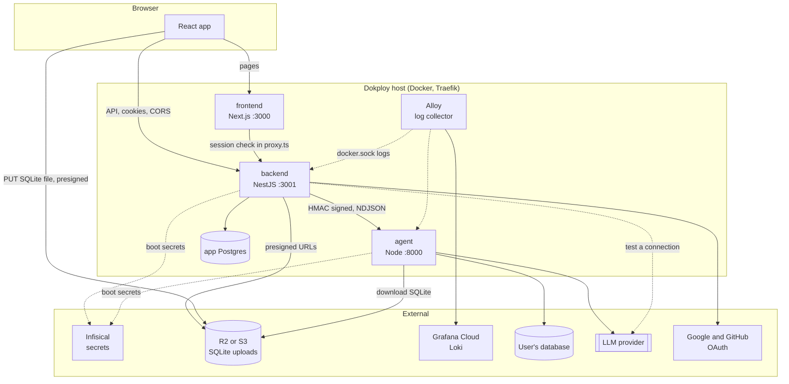
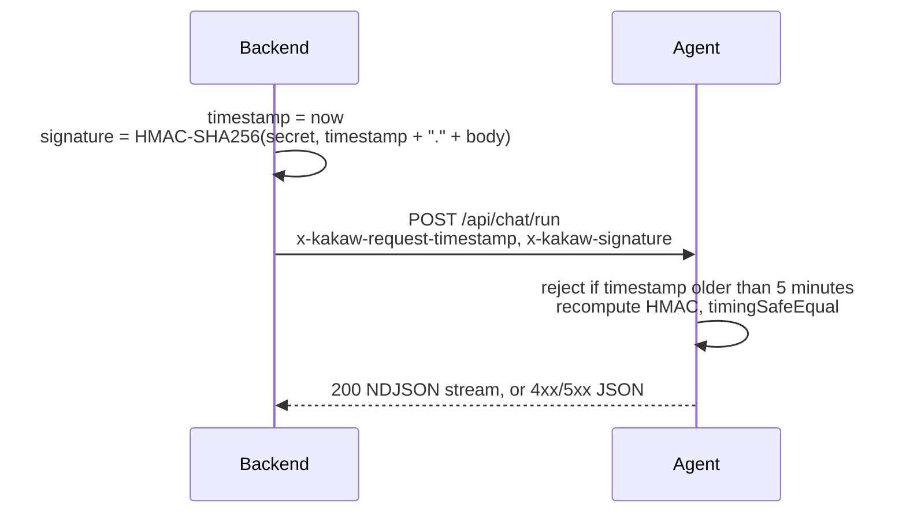
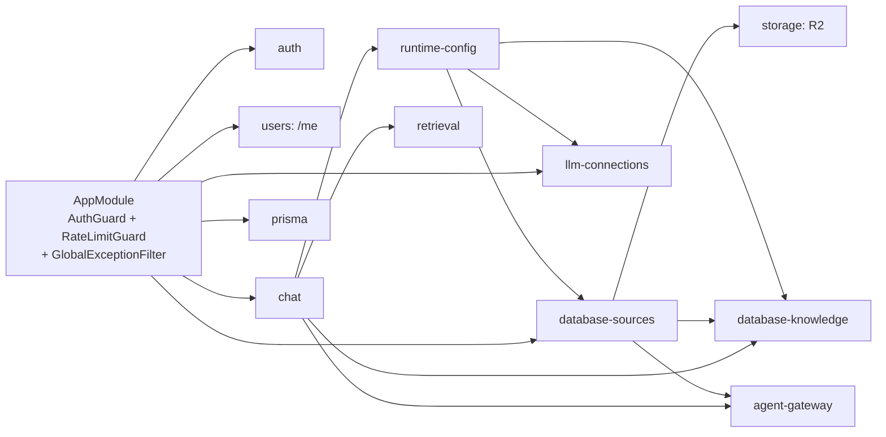

# 01 System overview

## The services

| Service | Job | Talks to |
| --- | --- | --- |
| **Frontend** | The web app: login, onboarding, chat, docs, landing page | Backend (browser and server side) |
| **Backend** | The API and the only service with a user-facing session. Owns users, conversations, saved connections, query memory | App database, agent, object storage, Infisical |
| **Agent** | Turns a question into a query, runs it, writes the answer, plans a chart. Stateless apart from in-process caches | The user's database, the user's LLM, Infisical |
| **Monitoring** | Alloy collector that ships container logs to Grafana Cloud Loki | Docker socket, Grafana Cloud |

The backend is the gatekeeper. The browser never calls the agent, and the agent never reads the app database. Everything the agent needs for one turn arrives in a single signed request.

## Containers

## Why it is split this way

- **Agent separate from backend.** The agent dials arbitrary user-supplied hosts (a customer database, a custom LLM endpoint). Keeping that in its own container, with its own network guard, keeps that reach away from the app database and the session layer.
- **Backend resolves, agent executes.** The backend decrypts the user's keys and connection strings and builds a self-contained `AgentRunRequest`. The agent holds no user state between requests.
- **Streaming end to end.** The agent streams NDJSON events, the backend relays them (persisting as it goes), and the browser applies them to its cache as they arrive.

## How the services authenticate to each other

`AGENT_SHARED_SECRET` is loaded from Infisical by both services at boot. The agent exposes three routes:

| Route | Purpose |
| --- | --- |
| `GET /healthz` | Liveness, used by the Docker health check |
| `POST /api/chat/sync` | Introspect a database and return its catalog |
| `POST /api/chat/run` | Run one chat turn and stream events |

## Backend modules

Every route needs a session unless marked `@Public()` (only `GET /api/health`). A global rate-limit guard budgets requests per user per minute; chat runs, syncs and connection tests have tighter limits. Counters are in memory, which is correct for one replica.

### HTTP API

| Area | Routes |
| --- | --- |
| Auth | `/api/auth/*` (better-auth: Google and GitHub sign-in, session) |
| Me | `GET /api/me/onboarding-state`, `/connections`, `/llm-connections`, `/chat-options`; `DELETE /api/me` |
| Database sources | `POST /api/database-sources`, `POST uploads/presign`, `POST :id/refresh`, `DELETE :id` |
| LLM connections | `POST /api/llm-connections`, `POST :id/activate`, `POST :id/deactivate`, `DELETE :id` |
| Chat | `GET/POST /api/chat/conversations`, `GET/DELETE conversations/:id`, `POST conversations/:id/runtime`, `POST conversations/:id/messages/stream`, `POST .../messages/:messageId/retry`, `PATCH .../traces/:traceId/feedback` |
| Health | `GET /api/health` |

## Supported inputs

| | Supported |
| --- | --- |
| User databases | PostgreSQL and MongoDB (connection string), SQLite (`.db`, `.sqlite`, `.sqlite3` upload) |
| LLM providers | OpenAI, Anthropic, Google, OpenRouter, Ollama, LM Studio |
| Sign-in | Google, GitHub |

The organization profile README also mentions MySQL and Snowflake. The code has no introspection or query path for either, so they are not supported yet.
