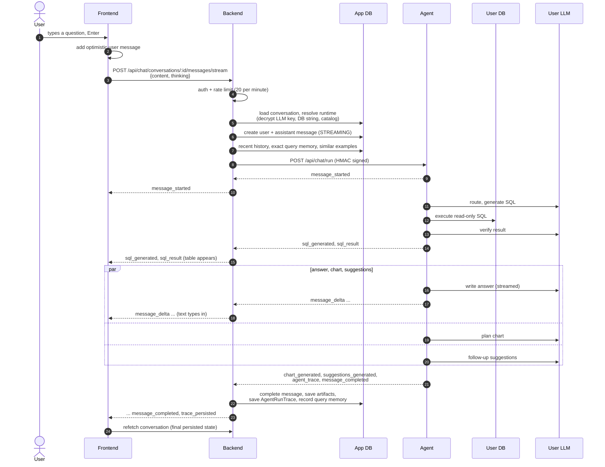
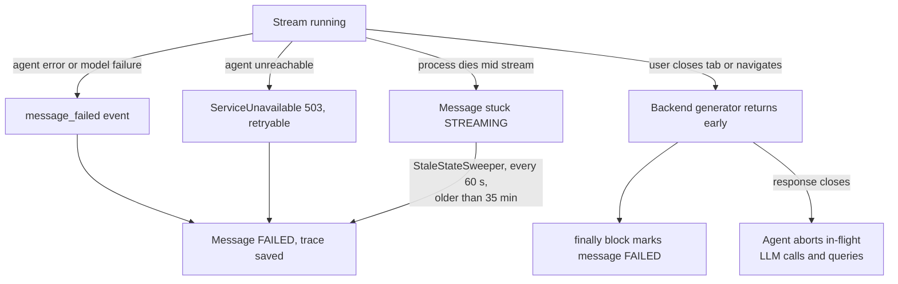

# 02 Chat request flow

One question, from keypress to answer.

## End to end

## What each layer does

**Frontend** (`ChatPageClient.tsx`, `lib/queries/conversations.ts`)
- Appends an optimistic user message, then calls `streamConversationMessage`, passing the Think toggle as `thinking`.
- Reads the response body as NDJSON and feeds each event to `applyStreamEvent`, which writes into the TanStack Query cache.
- When the stream ends it invalidates the conversation and list queries so the persisted version replaces the optimistic one.
- If the stream breaks mid-reply (tab in the background, phone locked, network drop) it does not mark the reply failed. It waits until the page is visible, calls `followConversationMessage` (`GET /api/chat/conversations/:id/messages/:messageId/stream`), resets the bubble and rebuilds it from the replayed events. The same happens when a chat opens with a reply still `STREAMING` (reload, another tab). A 204 means the server is no longer writing it; the refetch then shows the stored result.
- A first message from `/chat` creates the conversation first, navigates to `/chat/:id`, then streams.

**Backend** (`chat.service.ts`)
1. Loads the conversation and checks its LLM connection is usable.
2. `RuntimeConfigService.resolve` builds the runtime: decrypted API key, base URL, the database source (with a presigned download for SQLite) and the cached schema catalog.
3. Creates the message pair, then in parallel fetches the last 24 history messages, an exact query-memory hit and similar past questions.
4. Streams from the agent through `AgentGatewayService`, collecting artifacts and trace data as events pass.
5. On completion it persists the message, artifacts and an `AgentRunTrace`, records query memory from the trace, and sends a final `trace_persisted` event carrying the trace id, the handle for rating the message.
6. On failure it marks the message `FAILED`. A sweeper catches rows left `STREAMING` by a crashed process.

The run is not tied to the request that started it. `ChatController` drains the generator in the background and keeps every event of the running reply in `EphemeralStateService` (in memory, per process). The first request and any later `GET .../messages/:messageId/stream` are readers: each gets the events so far, then the live ones. A browser that goes away no longer stops or fails the reply. With more than one backend replica a re-attach can reach the wrong process; it gets 204 and the frontend falls back to polling the stored message.

**Agent**: see [03 The agent](03-agent.md).

## Stream events

| Event | From | Meaning | UI effect |
| --- | --- | --- | --- |
| `message_started` | agent | Run accepted | Show the assistant bubble |
| `agent_step` | agent | A progress line, such as "Executing SQL..." | Step log |
| `sql_generated` | agent | The accepted SQL | SQL artifact |
| `sql_result` | agent | Columns, rows, row count | Table artifact |
| `message_delta` | agent | A chunk of the written answer | Text streams in |
| `chart_generated` | agent | Chart spec | D3 chart |
| `suggestions_generated` | agent | Up to three follow-ups | Clickable chips |
| `agent_trace` | agent | Steps, tool calls, repair history, cache info | Stored, not shown live |
| `message_completed` | agent | Final text and token usage | Bubble finalised |
| `message_failed` | agent or backend | Error with code and retryable flag | Error state, retry button |
| `trace_persisted` | backend only | Trace id | Stored on the message as `traceId`, the handle a rating would use (no rating control in the UI yet) |

The wire format is one JSON object per line (`application/x-ndjson`). The backend excludes this route from gzip, since compression buffers and would hold back tokens.

## Failure and cancellation

- When the backend hangs up, the agent's `AbortController` fires and cancels in-flight model calls and SQL, so nothing keeps costing tokens for nobody.
- The backend caps one agent stream at 30 minutes. Each LLM call has its own timeout (see [03](03-agent.md#timeouts-and-thinking)).
- Retry (`POST .../retry`) resets the failed assistant message in place and re-runs the same question; no duplicate turn is created. Retry does not carry the Think toggle, so it runs with thinking on.
