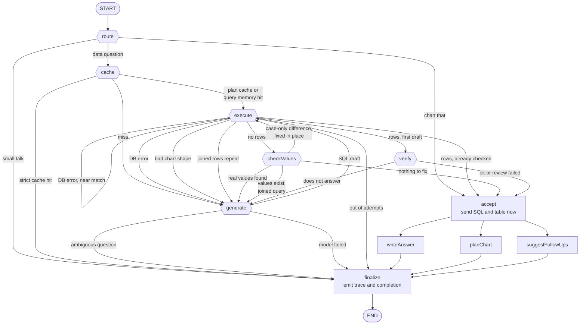
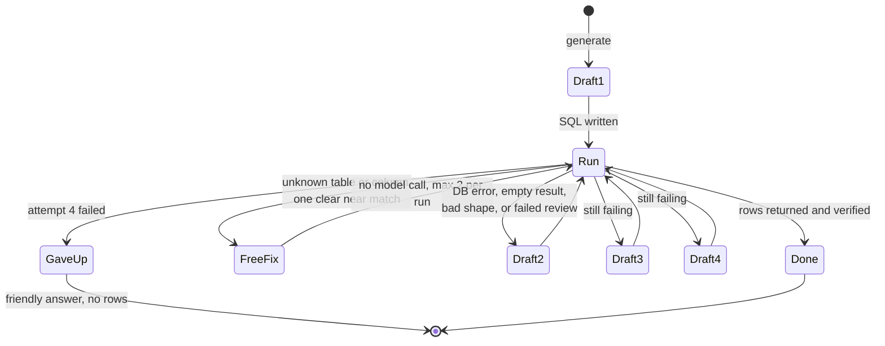
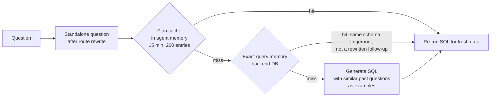
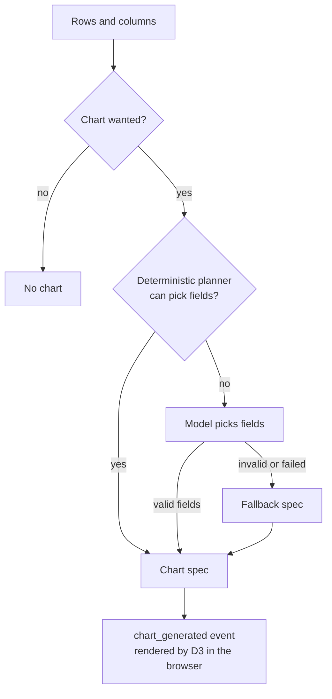

# 03 The agent

The agent is a [LangGraph](https://langchain-ai.github.io/langgraphjs/) state graph, built once at startup in `agent/src/agent/graph.ts`. Each node is wrapped by `instrumented()`, which logs, times and traces it. Everything request-specific travels in the run context, so the graph never closes over a request.

## The graph

The three nodes after `accept` run in parallel. `finalize` waits for all of them.

## Nodes

| Node | File | What it does | Model call |
| --- | --- | --- | --- |
| `route` | `route.ts` | Decides if the turn is small talk, a chart request on the previous result, or a data question. With history, rewrites a follow-up such as "what about 2025?" into a standalone question. | Only when there is an earlier assistant turn |
| `cache` | `plan.ts` | Looks for SQL already known for this question: the in-process plan cache, then the backend's exact query memory. | No |
| `generate` | `plan.ts` | Writes the SQL, or asks one clarifying question (with up to four clickable options) when the request has several readings. | Yes |
| `execute` | `execute.ts` | Checks chart plausibility, runs the SQL read-only, normalises database errors, applies free identifier fixes. A joined result that repeats itself (exact copies, or two or more columns holding one value on every row) gets one rewrite. Then `cleanRepeatedRows` cleans whatever comes back, in code: exact copies are dropped and columns with one value on every row keep it on the first row only. | No |
| `checkValues` | `values.ts` | On an empty result, finds the string filters (SQL `=`, `IN`, `LIKE`; for MongoDB, equality, `$in` and `$regex` in the leading `$match` stages), looks each filtered value up directly (ignoring case, up to 5 matches), then in a sample of up to 100 stored values. A case-only difference is fixed in place. A value that is missing goes back to `generate` with the stored values. When every value exists and the query has a join, it goes back once with a note that the join is the likely cause. | No |
| `verify` | `verify.ts` | Reviews the result against the question once. | Yes |
| `accept` | `finish.ts` | Sends `sql_generated` and `sql_result` to the client immediately. Records the accepted query as `sql_execution`. | No |
| `writeAnswer` | `finish.ts` | Streams the written answer. | Yes |
| `planChart` | `finish.ts` | Plans a chart: deterministically if possible, else with the model, else a fallback spec. | Sometimes |
| `suggestFollowUps` | `finish.ts` | Up to three follow-up questions, grounded in the current result only. | Yes |
| `finalize` | `finish.ts` | Caches the plan and emits chart, suggestions, trace and completion. | No |

## The repair loop

Most failures return to `generate` with what went wrong. The budget is enforced in one place, `retryOrGiveUp`.

| Limit | Value | Where |
| --- | --- | --- |
| SQL drafts per run | 4 (the first plus three repairs) | `MAX_GENERATIONS` in `plan.ts` |
| Free identifier fixes per run | 2 | `MAX_FREE_REPAIRS` in `execute.ts` |
| Filters probed on an empty result | 3, showing up to 30 stored values each | `values.ts` |
| Join rewrites when the filtered values exist | 1 | `checkValues` in `values.ts` |
| Review rewrites | 1 (the rewrite is not reviewed again) | `verify.ts` |
| Rewrites for repeated rows | 1, then a clean-up in code | `repeatedRows`, `cleanRepeatedRows` in `execute.ts` |
| Graph recursion limit | 60 | `graph.ts` |

A review that fails (the model errors) lets the result through rather than failing the turn. `VERIFY_RESULTS=false` turns the review off.

## What the model sees

- **System prompt**: dialect rules plus the full schema catalog. It stays byte-identical between attempts so Anthropic's prompt cache can serve repairs. The failing SQL and errors go in the user message.
- **History**: up to 12 earlier messages, with up to 5 result rows per replayed turn.
- **Few-shot examples**: similar past questions and their SQL, supplied by the backend from query memory.
- **Result rows in the answer prompt**: at most 20, plus computed aggregates. The user already sees the full table.
- **Structured output**: `route`, `generate`, `verify`, `planChart` and `suggestFollowUps` use `withStructuredOutput` with Zod schemas. A reply that does not fit is an error that carries the raw text and token usage.

## Reuse: three layers

| Layer | Lives in | Key | Notes |
| --- | --- | --- | --- |
| Plan cache | Agent process | Hash of schema identity plus the normalised standalone question | LRU with TTL. `RESULT_CACHE_STRICT=true` also reuses the answer and rows; the default re-runs the SQL so data stays fresh |
| Exact query memory | Backend DB (`query_memory_entries`) | Hash of source id plus normalised question | Only `ACTIVE` entries whose schema fingerprint still matches. Skipped for rewritten follow-ups, since "what about Latin America?" means nothing alone |
| Similar examples | Backend, in-process vector index | Cosine similarity of 384-dim embeddings, floor 0.6 | Few-shot examples only; they never skip generation |

SQL from either cache is not re-reviewed by `verify`, since it was checked when first accepted.

## Charts

`planChart` runs only when the user asked for a visual or the result looks chartable, and only if there is a numeric column.

Requested chart fields (for example "orders by country as a stacked bar") are reconciled with the real catalog in `route`, and checked again against the SQL and the result in `execute`, so a requested dimension is not silently dropped. When a request cannot be honoured exactly, the answer says how it was narrowed.

## Timeouts and thinking

| Setting | Hosted providers | Ollama, LM Studio |
| --- | --- | --- |
| Per LLM call timeout | 180 s (`LLM_TIMEOUT_MS`) | 10 min (`LOCAL_LLM_TIMEOUT_MS`) |
| Streaming calls | The timeout covers time to the first chunk only; a long answer is never cut for being long | Same |
| SQL query timeout | 30 s (`QUERY_TIMEOUT_MS`) | n/a |

The timeout aborts the HTTP request rather than racing it, so a slow provider stops costing tokens when the agent gives up. The run's own signal (client gone, shutdown) aborts the same way. Thinking models take 45 to 70 s to draft a query against a large catalog, which is why the hosted limit is 180 s; the backend writes a blank keep-alive line every 20 s, so Cloudflare's 100 s idle limit does not cut a long wait.

When a rewrite (a `generate` call with feedback) times out or fails, and the query it was fixing ran, the run answers from that query's result instead of failing. Query memory does not learn that query, since its rewrite was still pending.

**Thinking.** Reasoning models spend most of their latency on hidden thinking. Two things reduce it:

- Calls that do not need deep reasoning are marked `light`: `route`, `verify`, `writeAnswer`, `planChart`, `suggestFollowUps`. SQL generation is not light.
- The user can turn thinking off from the **Think** button in the chat bar. That sets `llm.disableThinking`, which applies the same low-thinking mode to every call, including SQL generation.

Low-thinking mode is provider specific (`lowThinkingOptions` in `llm/langchain.ts`):

| Provider | Effect |
| --- | --- |
| Google | `gemini-2.5-*`: thinking budget 0 (128 for Pro). Gemini 3 and later: level `LOW` |
| OpenAI | `o*` and `gpt-5`+ models (not `-chat`): `reasoningEffort: "low"` |
| OpenRouter | `reasoning.effort = "low"` (ignored by non-reasoning models) |
| Anthropic | Nothing needed; it thinks only when asked |
| Ollama, LM Studio | `" /no_think"` appended to the user prompt (the Qwen-family soft switch). Other local models ignore it |

## Safety of the SQL

Two layers, and only the second is a boundary.

1. `assertReadOnlySql` (`database/safety.ts`): one statement, must start with `SELECT`, `WITH`, `EXPLAIN` or `PRAGMA`, and write keywords are rejected. This is a cheap filter that gives the model a clear error to repair against. Keyword matching cannot see side-effecting functions, so it is not trusted as protection.
2. Enforcement in `database/query.ts`:
   - **Postgres**: `BEGIN TRANSACTION READ ONLY`, `SET LOCAL statement_timeout`, a `DECLARE ... NO SCROLL CURSOR`, so at most 200 rows leave the database. Pools are cached per connection string (32 max, LRU, 5 connections each).
   - **SQLite**: the file is opened read-only inside a separate child process that is killed on timeout. A synchronous `better-sqlite3` call cannot be interrupted, and on the main thread it would stall every other request.
   - **MongoDB** (`database/mongo.ts`): the model writes a native aggregation query as Extended JSON, `{"collection": ..., "pipeline": [...]}`, in the draft's `sql` field (`MongoSqlPromptBuilder`), so `{"$oid": ...}` and `{"$date": ...}` become real ObjectIds and dates. `parseMongoQuery` rejects text that is not that shape as a syntax error, which the repair loop shows the model. The pipeline is rejected if it contains `$out`, `$merge`, `$where`, `$function` or `$accumulator`, and only `aggregate` is called, with `maxTimeMS` and a `$limit` of 200. A query reading a missing collection (its own, or a `$lookup`, `$graphLookup` or `$unionWith` source) fails as `relation "x" does not exist`, so the usual unknown-table repair applies. Sub-documents in results are flattened to dot-path columns. The SQL chart check (`assessVisualizationSqlDraft`) is skipped; the result's columns are still checked. Query memory written while MongoDB sources were queried in SQL (through NoQL, until 2026-11-24) is ignored for them, since only text starting with `{` runs. The connection string must name a database and may carry only an allow-list of options, pool and timeout options included (the client's own settings override them): AWS and OIDC sign-in, `tls*File` paths and proxies are refused. Host names, SRV targets included, resolve through the private-network guard (`lookup: publicLookup`). Sockets skip `lookup` for IP literals, so seed hosts given as IPs are checked before connecting and unix-socket hosts are refused. A replica-set member the server announces at a private IP drops the client and fails its queries; the driver's first heartbeat to that member can still go out before the event fires. Result documents stay nested, so secret-looking fields are redacted at every depth. A time-limit error (code 50) reads like the other dialects' timeout. Clients are cached like the Postgres pools.

MongoDB introspection samples 100 documents per collection with `$sample`. Nested sub-documents become dot-path columns (`address.city`), arrays stay one column, the most common BSON type wins, a field missing from any sample is nullable, and a collection keeps its 100 most common fields.

Result rows pass through `sanitizeRow` (`database/sanitize.ts`), which hides fields whose names look like secrets.

## Run logging and tracing

`RunLogger` writes JSON logs per node (`requestId`, `userId`, `messageId`, `event`, `layer`) and totals token use across the run. Optional tracing sinks:

| Sink | Enabled by |
| --- | --- |
| OpenTelemetry (traces, metrics, logs) to Alloy | `OTEL_EXPORTER_OTLP_ENDPOINT` |
| Latitude | `LATITUDE_API_KEY`, `LATITUDE_PROJECT_SLUG` |
| LangSmith | `LANGSMITH_TRACING=true`; the run's outcome is posted as feedback so failures are filterable |

## Accuracy evaluation

`agent/eval/` holds 29 questions with known-correct SQL against a seeded shop database. It covers basics, filter-value traps, greeting prefixes, follow-ups, "chart that" requests and ambiguous questions. Run it with `npx tsx eval/run.ts --label <name>`; results go to `eval/results/`. On a local `qwen/qwen3.5-9b` the graph scores 28 of 29, against 20 of 29 for the earlier layered pipeline, at about 2.1 model calls per SQL question.
