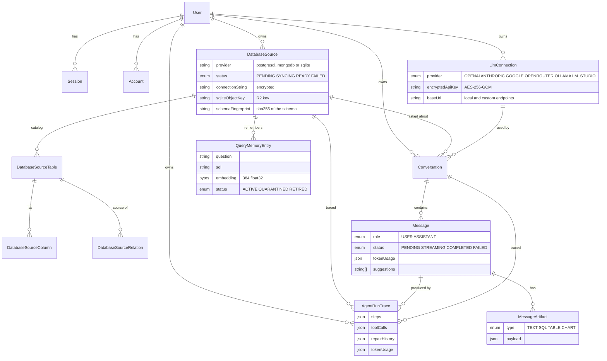
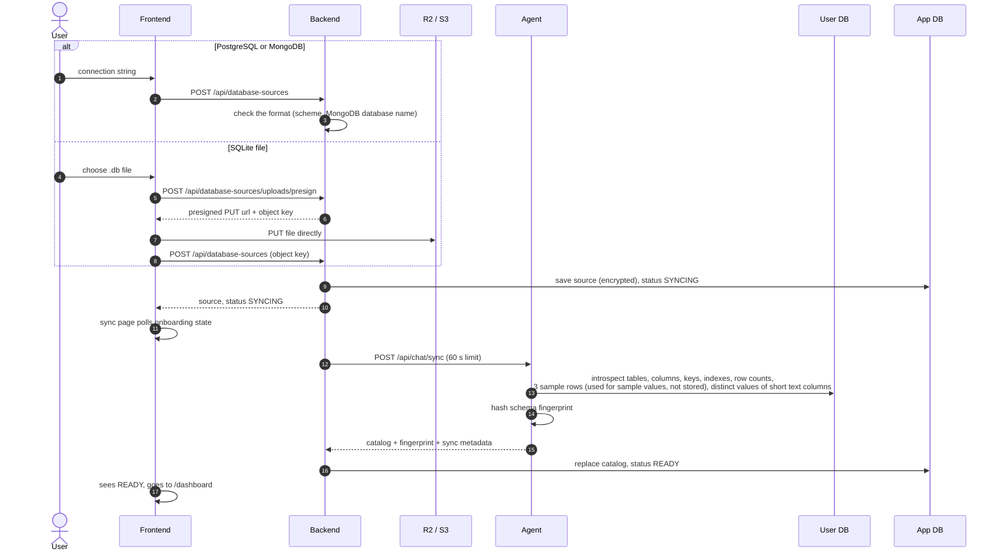
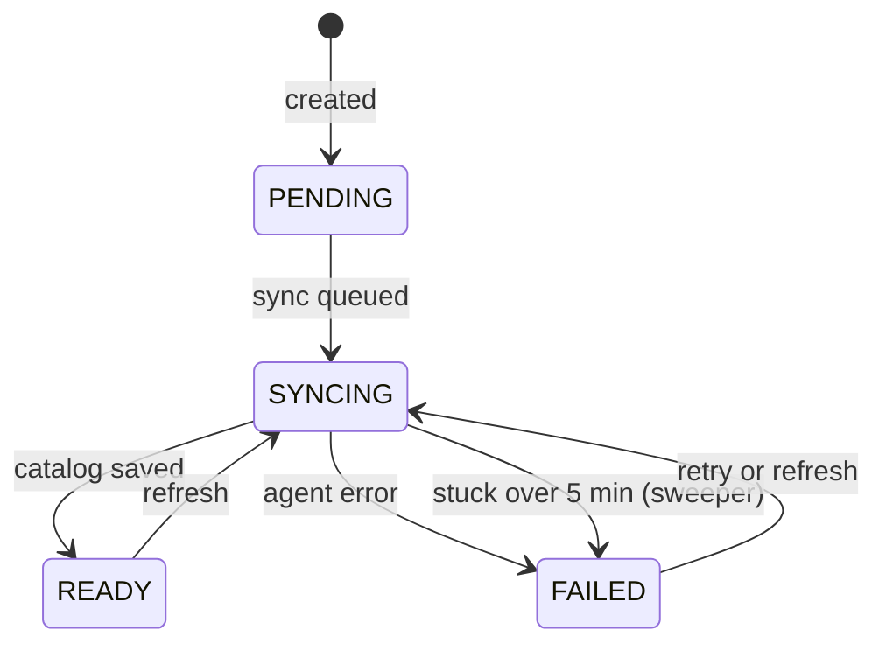
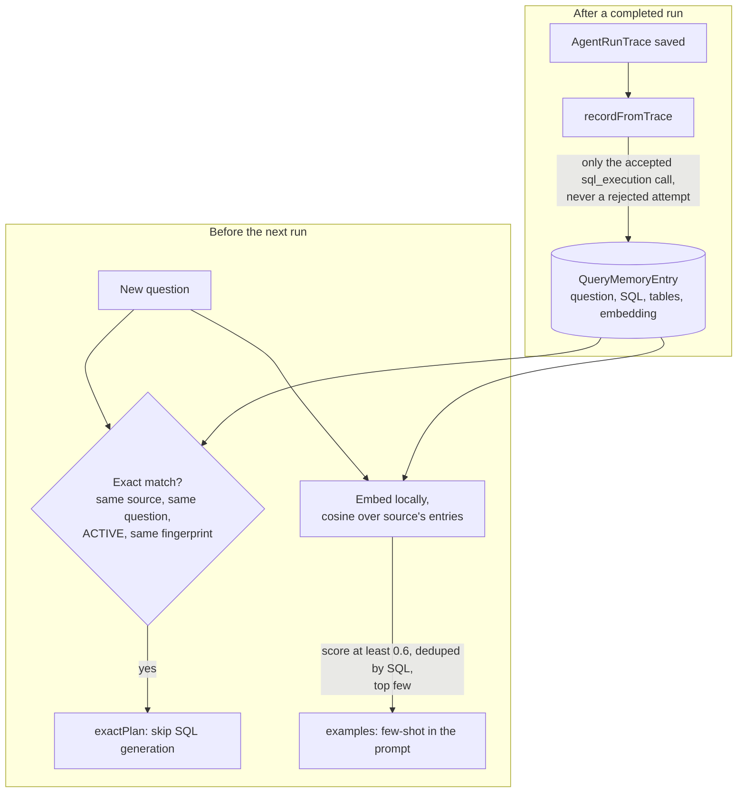

# 04 Data and sync

## App database (PostgreSQL, Prisma)

Prisma migrations live in `backend/prisma/migrations`. The backend creates the database if it is missing and applies migrations at boot (`config/database.bootstrap.ts`).

Every record chains back to a `User` with `onDelete: Cascade`, so deleting an account removes everything it owns. Better Auth's own tables (`users`, `sessions`, `accounts`, `verifications`) share the same database.

### What each group is for

| Group | Tables | Purpose |
| --- | --- | --- |
| Identity | `users`, `sessions`, `accounts`, `verifications` | Better Auth |
| Connections | `database_sources`, `llm_connections` | What the user connected. Secrets are stored encrypted |
| Catalog | `database_source_tables`, `_columns`, `_relations` | The cached schema the agent prompts with. Columns keep a few sample values; short text columns (up to 50 distinct values, tables up to 200k rows, not secret-named) keep all of them in the same `sampleValues` field, and the prompt renders those as `values:` |
| Chat | `conversations`, `messages`, `message_artifacts` | The transcript. SQL, table and chart results are artifacts of an assistant message |
| Telemetry | `agent_run_traces` | One row per run: question, steps, tool calls, repair history, chart spec, token usage, cache hit, error |
| Learning | `query_memory_entries` | Questions this source has answered correctly, with the SQL that ran |

## Connecting a database (onboarding and sync)

The frontend `proxy.ts` sends a new user through `/onboarding/database`, `/onboarding/connection` and `/onboarding/sync` before they can reach `/chat`.

If the sync fails the source becomes `FAILED` with `lastError`, and the sync page offers a retry (`POST /api/database-sources/:id/refresh`).

Only a `READY` source can start a chat.

### The schema fingerprint

`fingerprintCatalog` hashes only facts about the customer's schema: table and column names, types, nullability, primary keys, ordinal positions, indexes and foreign keys. Row counts and sample values are left out on purpose, so a sync of an unchanged schema keeps the same fingerprint and query memory stays valid. Indexes are read only for the fingerprint; the backend does not store them.

The fingerprint is the key that makes cached SQL safe:

- Query memory and the plan cache only reuse SQL written for the current fingerprint.
- After a refresh that changes the schema, old entries stop matching, because their SQL may name columns that no longer exist.

### SQLite path

The browser uploads straight to object storage with a presigned URL (max 25 MB, and `.db`, `.sqlite`, `.sqlite3` extensions checked at presign time). For each run the backend adds a presigned download URL. The agent downloads the file once into a temp cache (`/tmp/kakaw-sqlite`, keyed by the immutable object key, evicted after 7 days idle) and queries it read-only.

## Query memory (learning from answers)

Every completed run already stored its question and the SQL that produced the answer in `agent_run_traces`. Query memory turns that into something the next run can use.

- **Embeddings run in the backend process** (`Xenova/all-MiniLM-L6-v2`, 384 dimensions, about 3 ms per question). There is no embeddings API call, no extra key, and no customer schema leaves the infrastructure. If the model cannot load, retrieval quietly returns nothing and chat keeps working.
- **Isolation is structural**: entries belong to a `DatabaseSource`, which belongs to a user.
- One entry per question per source (`questionHash`), so asking again and getting it right overwrites a bad entry.
- Statuses: `ACTIVE`, `QUARANTINED`, `RETIRED`. A resync retires an entry whose SQL uses a table or column the new schema lacks.
- `npm run backfill:query-memory` rebuilds entries from existing traces.

## Knowledge book ("Improve accuracy")

The sync records structure; the book records meaning. A user starts it per database from **Improve accuracy** with one of their LLM connections.

- **Backend is the dispatcher** (`backend/src/book/book.service.ts`). It upserts one `database_books` row, orders the catalog tables by declared-FK degree then row count, and loops over them in process with concurrency 2, calling the agent's `POST /api/improve/table` once per table (retried up to 4 times with a growing pause, for provider rate limits). Each page is stored in `book_pages` with a hash of the table's columns and keys, so the next run only rereads changed tables; a `HUMAN` page is never overwritten. Then `POST /api/improve/overview` writes the overview. The run stops starting tables at 1,000,000 tokens (`PARTIAL`), on Stop (`cancelRequested`, `CANCELLED`) or after 3 consecutive failures (`FAILED`). A run that rereads every table counts against 3 per database per UTC day. On boot, `RUNNING` books become `PARTIAL`. Tokens go to `token_usage_entries` with `kind = 'improver'`.
- **Agent reads one table** (`agent/src/improver/`): a random sample of up to 200 rows (`TABLESAMPLE` over 50k rows), statistics over it, Postgres column comments and every row of small reference tables, then one structured model call. Each proposed join is checked by query and kept at 80% or more of sampled values found in the target.
- **Use at question time**: `getRuntimeKnowledge` attaches `knowledge.book` (read on every call, not cached with the catalog). The agent's `withBook` folds it into the catalog once per run: a note per table and column, and confirmed joins as relationships marked as not declared. The SQL and review prompts render those notes, so with no book the prompt is unchanged.
- **Debug view**: the GET response includes the pages only for emails in `BOOK_PAGES_VISIBLE_TO` (`*` for everyone).
- **Measured** on the messy ERP eval (`agent/eval/messy`, 26 questions, DeepSeek v4.1 Flash): 22/26 without the book, 26/26 with it, at about 13.7k instead of 4.2k input tokens per question. Building the book took about 104k tokens for 22 tables.

## Secrets at rest

| Value | Protection |
| --- | --- |
| LLM API keys, database connection strings | AES-256-GCM in `SecretsService`, key from `LLM_CONNECTIONS_ENCRYPTION_KEY`. Only the last four characters of a key are shown to the user |
| Service secrets (`AGENT_SHARED_SECRET`, OAuth, encryption key) | Infisical, loaded into `process.env` before any module reads them |
| Session | HTTP-only cookie from better-auth, optionally shared across subdomains with `COOKIE_DOMAIN` |
