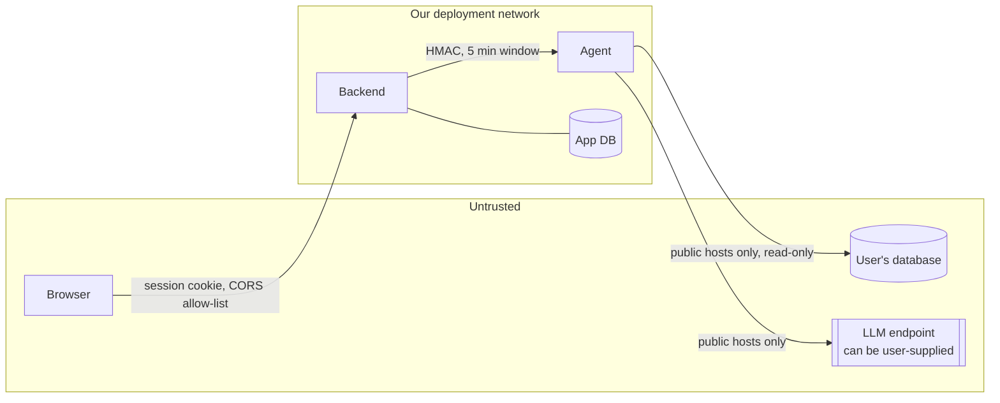
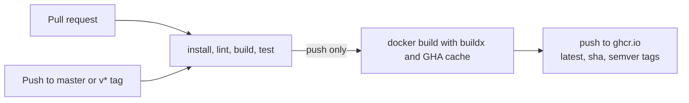
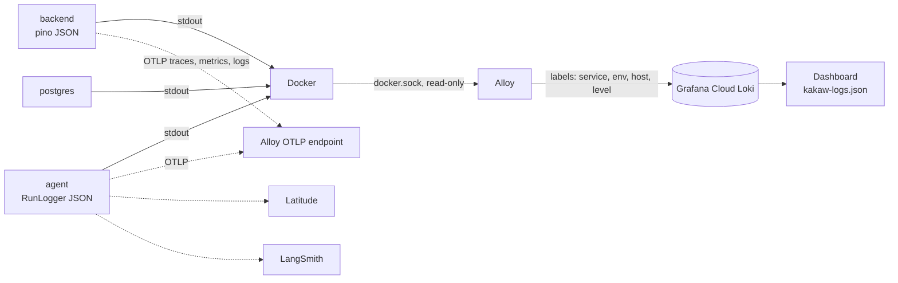

# 05 Security and operations

## Trust boundaries

The agent dials hostnames that users type. Without a guard, that would be a tunnel to everything the deployment network can reach: the app database, other containers, the cloud metadata address.

## Safeguards

| Risk | Defence | Where |
| --- | --- | --- |
| Generated SQL writes or alters data | First filter (SQL sources): single statement, read-only prefix, write keywords rejected. Real boundary: read-only transaction (Postgres), read-only file in a killable child process (SQLite), or an aggregation pipeline checked for `$out`, `$merge`, `$where`, `$function` and `$accumulator`, run with `aggregate` only (MongoDB, which has no read-only transaction; users are told to connect with the `read` role) | `agent/src/database/safety.ts`, `query.ts` |
| Runaway query | `statement_timeout` of 30 s; SQLite child killed on timeout; MongoDB `maxTimeMS` of 30 s and a `$limit` of 200; at most 200 rows leave the database via a cursor | `agent/src/database/query.ts` |
| Server-side request forgery through a user database or LLM URL | Blocks loopback, private, link-local, carrier-grade NAT, multicast and metadata ranges. Checked before the run starts in `server.ts`, and again at socket level (`guardedSocket`) so a DNS rebind cannot slip past. Production only; `ALLOW_PRIVATE_HOSTS=true` opts out for self-hosting | `agent/src/net/public-host.ts`, `backend/src/common/net` |
| Redirect walks past the URL check | OpenAI-compatible client uses `redirect: "error"` | `agent/src/llm/langchain.ts` |
| Forged calls to the agent | HMAC-SHA256 over timestamp and body, constant-time compare, 5 minute window | `agent/src/auth.ts` |
| Stolen provider keys or connection strings | AES-256-GCM at rest; key from Infisical; only the last four characters shown | `backend/src/llm-connections/secrets.service.ts` |
| Secrets in results | Fields named like `password`, `secret`, `token`, `key`, `credential`, `auth`, `session` come back as `[redacted]` | `agent/src/database/sanitize.ts` |
| Secrets in logs | pino redacts `cookie`, `authorization` and the signature header | `backend/src/app.module.ts` |
| Abuse and cost | Per-user request budget; tighter limits on chat runs (20 per minute), syncs and connection tests. In memory, correct for one replica | `backend/src/common/guards/rate-limit.guard.ts` |
| Customer data in logs | Not redacted: in production each `llm_call` and `llm_response` log carries up to 2,000 characters of each prompt and reply, which can include questions, schema and result values. The privacy page says so | `agent/src/agent/logger.ts` |
| Cross-tenant data | Query memory, traces and catalogs hang off a `DatabaseSource` that belongs to one user; every lookup is scoped by user | Prisma schema |
| Oversized agent request | Body buffered with a 64 MB cap before the signature check | `agent/src/server.ts` |
| Data deletion | `DELETE /api/database-sources/:id` and `DELETE /api/me` remove records and uploaded files; cascades handle the rest | backend |

Kakaw reads only the schema and a few sample rows for the catalog. Result rows are sent to the user's chosen LLM provider to write the answer, so the privacy page points users to that provider's policy.

## CI and images

All three services have the same pipeline (`.github/workflows/ci.yml`).

CI stops at publishing the image. The Dokploy deployment that runs it is configured on the host, not in these repositories.

| Service | Image | Base | Port | Health check |
| --- | --- | --- | --- | --- |
| frontend | none: CI builds and tests it but publishes no image, and the repo has no Dockerfile. How it is deployed is not recorded in the repo | Node | 3000 | |
| backend | `ghcr.io/<owner>/kakaw-backend` | `node:22-slim`, multi-stage | 3001 | `GET /api/health` (reports DB reachability) |
| agent | `ghcr.io/<owner>/kakaw-agent` | `node:22-alpine`, multi-stage | 8000 | `GET /healthz` |

The backend CI also asserts `dist/main.js` exists, since a stray `.ts` file outside `src/` would move the entry point and the container could not start.

## Logs, metrics and traces

- Both services emit one JSON object per line. Alloy turns `service`, `env`, `host` and `level` into labels. High-cardinality fields (`requestId`, `userId`, `messageId`, `event`, `layer`) are deliberately not labels, so filter on them with LogQL: `{service="agent"} | json | requestId="..."`.
- The `x-request-id` header is reused or minted for every request and echoed back, so one request can be followed across services.
- `GET /api/auth/get-session`, `GET /api/me/onboarding-state` and `GET /api/health` are not logged; the frontend polls them constantly.
- Every chat run also stores an `AgentRunTrace` row, so a past answer can be replayed step by step from the database.

## Configuration map

Secrets come from Infisical at boot (`INFISICAL_CLIENT_ID`, `INFISICAL_CLIENT_SECRET`, `INFISICAL_PROJECT_ID`, `INFISICAL_ENVIRONMENT`, `INFISICAL_SECRET_PATH`, `INFISICAL_SITE_URL`). Never commit a `.env` file.

| Setting | Service | Meaning | Default |
| --- | --- | --- | --- |
| `DATABASE_URL` | backend | App Postgres | |
| `AGENT_SERVICE_URL` | backend | Where the agent is | `http://localhost:8000` |
| `AGENT_SHARED_SECRET` | backend, agent | HMAC key between them | |
| `LLM_CONNECTIONS_ENCRYPTION_KEY` | backend | Encrypts keys and connection strings | |
| `BETTER_AUTH_SECRET`, `BETTER_AUTH_URL` | backend | Session signing, public URL | |
| `GOOGLE_*`, `GITHUB_*` | backend | OAuth client ids and secrets | |
| `FRONTEND_URL` | backend | CORS and trusted origin | `http://localhost:3000` |
| `COOKIE_DOMAIN` | backend | Share the session cookie across subdomains | off |
| `R2_BUCKET`, `R2_ACCESS_KEY_ID`, `R2_SECRET_ACCESS_KEY`, `R2_ACCOUNT_ID` or `R2_ENDPOINT` | backend | SQLite upload storage | |
| `EMBEDDING_ENABLED`, `EMBEDDING_MODEL_ID`, `QUERY_MEMORY_FLOOR` | backend | Query memory tuning | on, MiniLM, 0.6 |
| `ALLOW_PRIVATE_HOSTS` | backend, agent | Allow private addresses in production | off |
| `NEXT_PUBLIC_API_URL` | frontend | Backend origin | production backend |
| `LLM_TIMEOUT_MS` | agent | Hosted LLM call timeout | 180 000 |
| `LOCAL_LLM_TIMEOUT_MS` | agent | Ollama and LM Studio call timeout | 600 000 |
| `QUERY_TIMEOUT_MS` | agent | One user SQL query | 30 000 |
| `VERIFY_RESULTS` | agent | Turn the result review on or off | true |
| `RESULT_CACHE_MAX`, `RESULT_CACHE_TTL_MS`, `RESULT_CACHE_STRICT` | agent | Plan cache | 200, 15 min, false |
| `MAX_HISTORY_MESSAGES`, `MAX_HISTORY_ROWS`, `MAX_ANSWER_PROMPT_ROWS` | agent | Prompt size | 12, 5, 20 |
| `OTEL_*`, `LATITUDE_*`, `LANGSMITH_*` | agent, backend | Telemetry | off |

## Timeout map

Several timers have to agree, or a slow local model dies at the shortest one.

| Layer | Limit | Where |
| --- | --- | --- |
| One hosted LLM call | 180 s | `LLM_TIMEOUT_MS` (agent) |
| One local LLM call | 10 min | `LOCAL_LLM_TIMEOUT_MS` (agent) |
| One whole agent stream | 30 min | `agent-gateway.service.ts` (backend) |
| Message still `STREAMING` is marked failed | 35 min | `stale-state.sweeper.ts` (backend) |

The ordering is the rule: LLM call < agent stream cap < sweeper threshold. If you raise one, raise the ones after it.
