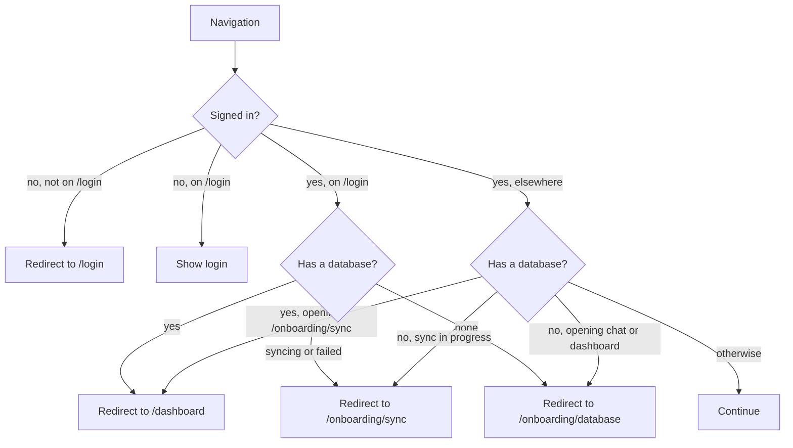
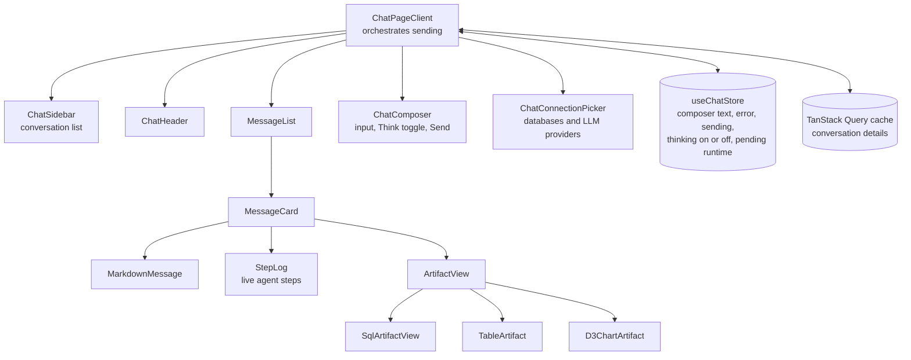
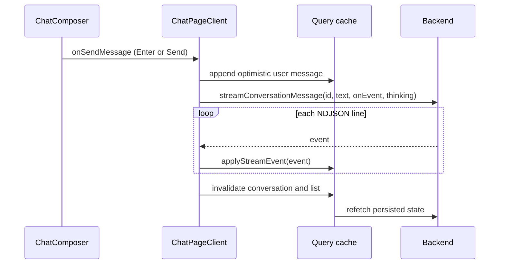

# 06 Frontend

Next.js 16 (App Router), React 19, Tailwind CSS 4, better-auth client, TanStack Query, Zustand and d3. This Next.js version has breaking changes from older releases. Read `node_modules/next/dist/docs/` before changing framework-level code (see `frontend/AGENTS.md`).

## Routes

| Route | Purpose | Guard |
| --- | --- | --- |
| `/` | Landing page | Public |
| `/login` | Sign in with Google or GitHub | Redirects away if already signed in |
| `/onboarding/database` | Choose and connect a database | Signed in |
| `/onboarding/connection` | Connection details | Signed in |
| `/onboarding/sync` | Wait for the first sync, retry on failure | Signed in |
| `/chat`, `/chat/[conversationId]` | The chat | Signed in and has a database |
| `/dashboard` | Renders the chat page (not indexed) | Signed in and has a database |
| `/docs`, `/docs/[slug]` | User guides written in MDX (`src/content/docs`) | Public |
| `/privacy`, `/terms` | Legal | Public |
| `/llms.txt`, `sitemap`, `robots`, Open Graph image | Discovery | Public |

## The route guard

`src/proxy.ts` runs on `/login`, `/chat`, `/dashboard` and `/onboarding` for every navigation. It asks the backend for the session and the onboarding state in one round trip, then redirects.

This is an optimistic redirect only. The backend authorises every API call itself.

## How the browser talks to the backend

`lib/api.ts` exports `apiFetch`, a `fetch` wrapper pointed at the backend with `credentials: "include"`. There is no same-origin proxy: the API is on a sibling subdomain, so the backend enables credentialed CORS for `FRONTEND_URL`, and `COOKIE_DOMAIN` shares the session cookie across both. Set `NEXT_PUBLIC_API_URL` for local development.

Server data lives in `lib/queries/*` (TanStack Query hooks): `conversations`, `chat-options`, `database-sources`, `llm-connections`, `onboarding`, `account`. UI-only state is in small Zustand stores.

## Chat screen

### Sending and streaming

- `chat-stream-state.ts` holds `applyStreamEvent`, a reducer over the cached conversation. A `message_delta` appends text, `sql_result` adds a table artifact, `chart_generated` a chart, `suggestions_generated` the chips, and `message_failed` the error state.
- `chat-formatting.ts` cleans the assistant text (strips stray chart-config blocks and partial JSON that a model may emit) and parses Markdown into blocks.
- If a reply is still streaming but this tab has no stream (after a reload, say), the conversation query polls until the backend marks the message complete.
- A stream error marks the streaming message failed locally and shows the error in the composer.

### The Think toggle

The **Think** button in the composer flips `thinkingEnabled` in `useChatStore`. Each send reads it and posts `{ content, thinking }`. When off, the backend sets `llm.disableThinking`, and the agent applies low-thinking mode to every call, including SQL generation (see [03](03-agent.md#timeouts-and-thinking)). The setting lasts for the page session, defaults to on, and does not carry over to Retry.

### Drafts

`useDraftCache` saves the composer text per chat (`kakaw:draft:<id>`, and `kakaw:draft:new` for a chat not yet created) so a reload or navigation does not lose it. It is cleared after a successful send.

### New chat

On `/chat` there is no conversation yet. The user picks a database and an LLM connection (`NewChatRuntimeSelect`, defaulting to the most recent conversation's pair). The conversation is created on the first send, then the app navigates to `/chat/<id>` and starts the stream.

## Charts

`D3ChartArtifact` renders the chart spec the agent sends: `bar`, `line`, `pie`, `scatter` and `histogram`, with optional series and stacked bars. The agent's spec type also names a `network` kind, but the browser has no renderer for it yet. The spec carries the data rows, so a chart renders without another query. "Chart that" on the previous result reuses the rows already in the conversation.

## Message feedback (not wired up yet)

The backend can take a rating: `PATCH /api/chat/conversations/:conversationId/traces/:traceId/feedback` with `positive` or `negative`, and a negative one retires the query-memory entry that run created (see [04](04-data-and-sync.md#query-memory-learning-from-answers)). The frontend already keeps each message's `traceId` from the `trace_persisted` event, but it has no thumbs up or down control and no call to that endpoint. Adding the control is the only missing piece.

## Tests

`frontend/test` uses Vitest. `npm run lint` and `npm run build` run in CI.
