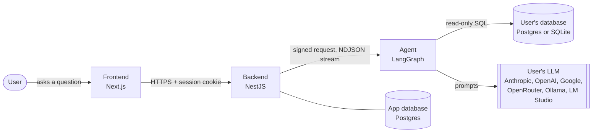
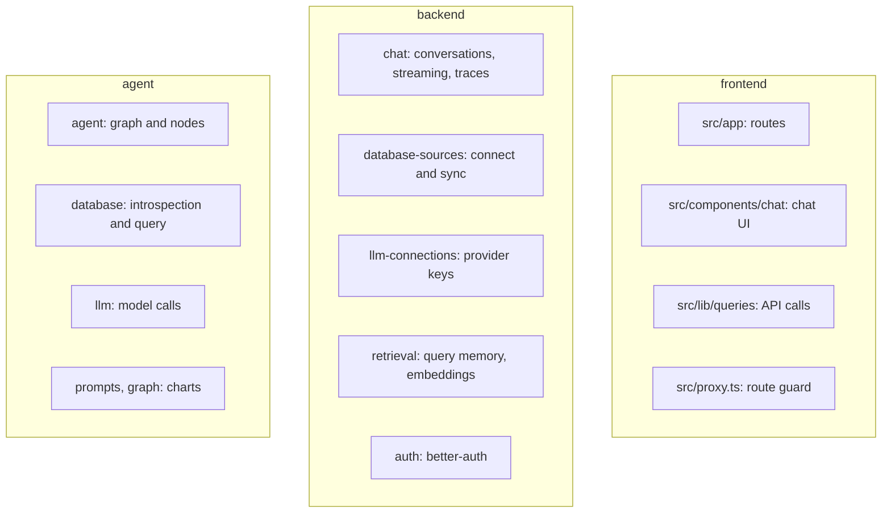

# Kakaw AI: how it works

Kakaw AI lets a person ask a database a question in plain English. It writes the SQL, runs it read-only, and returns a table, a chart and a written answer. The user brings their own LLM provider.

These docs describe the code as it is today, across the three services.

| Read | To learn |
| --- | --- |
| [01 System overview](01-system-overview.md) | The services, how they talk, where they run |
| [02 Chat request flow](02-chat-request-flow.md) | What happens from pressing Enter to the answer on screen |
| [03 The agent](03-agent.md) | The LangGraph pipeline: routing, SQL generation, repair, verify, caching, thinking and timeouts |
| [04 Data and sync](04-data-and-sync.md) | The database schema, onboarding, how a database is introspected, query memory |
| [05 Security and operations](05-security-and-operations.md) | Trust boundaries, safeguards, CI, deploy, logs and traces |
| [06 Frontend](06-frontend.md) | Routes, the route guard, chat state and streaming |

## The product in one picture

## Repositories

The workspace holds separate git repositories, not a monorepo.

| Folder | Repo | Stack | Port |
| --- | --- | --- | --- |
| `frontend/` | Kakaw-AI/frontend | Next.js 16, React 19, Tailwind 4, TanStack Query, Zustand, d3 | 3000 |
| `backend/` | Kakaw-AI/backend | NestJS, Prisma, PostgreSQL, better-auth | 3001 |
| `agent/` | Kakaw-AI/agent | TypeScript, LangGraph, LangChain | 8000 |
| `monitoring/` | Kakaw-AI/monitoring | Grafana Alloy, Docker Compose | 12345 (local UI) |
| `.github/` | Kakaw-AI/.github | Organization profile README | |
| `deprecaed/` | Kakaw-AI/deprecaed | Pre-split code, kept for reference | |

## Where things live

