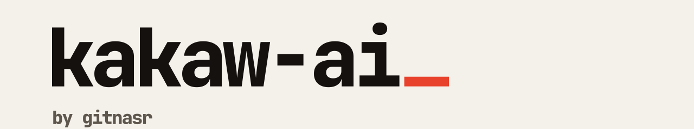

<picture>
  <source media="(prefers-color-scheme: dark)" srcset="assets/banner-dark.svg">
  
</picture>

Ask your database a question in plain English and get the answer as a table or a chart. Kakaw AI is for people who need the numbers but do not write SQL. You bring your own LLM provider.

[Website](https://kakaw.gitnasr.com) · [Docs](https://kakaw.gitnasr.com/docs) · [Getting started](https://kakaw.gitnasr.com/docs/getting-started)

## How it works

You connect a database (PostgreSQL, MySQL, Snowflake or SQLite) and an LLM provider (Anthropic, OpenAI, Google Gemini, Ollama or LM Studio). You ask a question. Kakaw writes the SQL, shows it to you, runs it read-only, and returns a table or a chart.

## Repositories

| Repository | What it is | Stack |
| --- | --- | --- |
| [frontend](https://github.com/Kakaw-AI/frontend) | The web app: onboarding, chat, docs | Next.js 16, React 19, Tailwind CSS 4 |
| [backend](https://github.com/Kakaw-AI/backend) | API: auth, chat, database connections, streaming | NestJS, Prisma, PostgreSQL |
| [agent](https://github.com/Kakaw-AI/agent) | Turns a question into SQL and an answer | TypeScript, LangGraph |
| [monitoring](https://github.com/Kakaw-AI/monitoring) | Ships container logs to Grafana Cloud | Grafana Alloy |
| [deprecaed](https://github.com/Kakaw-AI/deprecaed) | Pre-split code, kept for reference | |

## Contact

[dev@gitnasr.com](mailto:dev@gitnasr.com). Made by [gitnasr](https://gitnasr.com).
